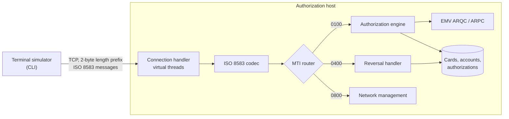

# iso8583-authorizer

A card **authorization host** that speaks ISO 8583: it receives authorization requests from terminals over TCP, applies issuer rules (card status, expiry, credit limit, duplicates, EMV cryptograms) and answers with the standard response codes, in a few milliseconds and without losing a cent under retries and reversals.

> **Status:** 🚧 in development. See the roadmap below.

## Why

Every card payment ends in a message like this one: a terminal asks the issuer *"can this card spend 250.00 MXN here?"* and has a few seconds to get an answer. The difficult parts are rarely the happy path:

- the same request **retransmitted** after a timeout must not be authorized twice;
- a **reversal** for a request whose answer was lost must restore the available credit exactly once;
- chip cards prove they are genuine with an **EMV cryptogram** (ARQC) that the issuer has to verify, and the issuer answers with its own (ARPC);
- all of it over a binary-framed TCP protocol with fixed and variable-length fields, defined by a **bitmap**.

This project implements those mechanics end to end, from bytes on the socket to the authorization decision.

## How it fits together

| Message | Meaning |
|---|---|
| `0100` / `0110` | Authorization request / response |
| `0400` / `0410` | Reversal advice / response |
| `0800` / `0810` | Network management (echo test) |

## Roadmap

- [x] ISO 8583 codec: MTI, primary and secondary bitmaps, fixed and LLVAR/LLLVAR fields
- [x] TCP server with length-prefixed framing on virtual threads
- [x] Authorization rules: card status, expiry, Luhn check, available credit, standard response codes
- [ ] Duplicate transmission detection with idempotent responses
- [ ] Reversals (`0400`) that restore available credit exactly once
- [x] Network management (`0800` sign-on, sign-off, echo)
- [ ] EMV: ARQC verification and ARPC generation with test keys
- [ ] Terminal simulator CLI
- [ ] Docker Compose setup

Design decisions are recorded as ADRs in [`docs/adr`](docs/adr).

## Authorization rules

Applied in order; the first rule that fails decides the response code (field 39).

| Rule | Declined with |
|---|---|
| Processing code is a purchase (`00xxxx`) | `12` invalid transaction |
| PAN passes the Luhn check and belongs to a known card | `14` invalid card number |
| Card is active (not blocked, lost or stolen) | `62` restricted card |
| Card is not expired | `54` expired card |
| Expiry date sent matches the card's | `05` do not honor |
| Amount is positive | `13` invalid amount |
| Currency matches the credit account's | `57` transaction not permitted |
| Available credit covers the amount | `51` insufficient funds |

An approval (`00`) returns a 6-digit authorization code (field 38) and holds the amount against the available credit, under a row lock on the account ([ADR 0003](docs/adr/0003-issuer-data-in-postgresql-with-tokenized-pans.md)). Card numbers are stored only as HMAC tokens plus BIN and last 4 digits.

## Scope and sources

Built only from **public** material: the ISO 8583:1987 data element definitions as widely documented, and the EMV specifications published by EMVCo. It does not use or reproduce any network's or processor's proprietary message specification. All keys are test keys and all card numbers are test numbers. It is a learning and portfolio project, not a certified payment system.

## License

[MIT](LICENSE)
