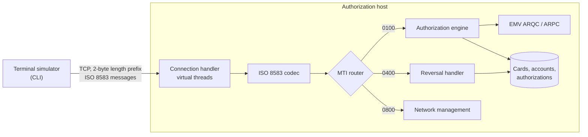

# iso8583-authorizer

[](https://github.com/armando-calz/iso8583-authorizer/actions/workflows/ci.yml)

A card **authorization host** that speaks ISO 8583: it receives authorization requests from terminals over TCP, applies issuer rules (card status, expiry, credit limit, duplicates, EMV cryptograms) and answers with the standard response codes, in a few milliseconds and without losing a cent under retries and reversals.

> **Status:** 🚧 in development. See the roadmap below.

## Quick start

Only Docker is required.

```bash
git clone https://github.com/armando-calz/iso8583-authorizer.git && cd iso8583-authorizer
docker compose up -d                    # PostgreSQL + the authorization host, with demo test cards
docker compose run --rm terminal demo   # a terminal walks through the host's behavior over ISO 8583
```

Every step states the response it expects and checks it (real output):

```text
Magnetic stripe purchase, retransmission and reversal
  ✓ 00 0110 Purchase 250.00 MXN  (22 ms)
  ✓ 00 0110 Same purchase retransmitted (no answer arrived)  (2 ms)
  ✓         ...gets the original authorization code, holds nothing again
  ✓ 00 0410 0400 reversal of the purchase  (6 ms)
  ✓ 00 0410 0400 reversal repeated  (1 ms)

EMV chip purchase
  ✓ 00 0110 Chip purchase 1,234.50 MXN  (17 ms)
  ✓         ...response carries a valid ARPC (issuer authenticated)
  ✓ 05 0110 Same chip data with field 4 changed to 9,999.00 (not what the chip signed)  (4 ms)
  ✓ 05 0110 Captured cryptogram replayed as a new transaction  (5 ms)
  ✓ 00 0410 0400 reversal of the chip purchase  (3 ms)

Declines
  ✓ 51 0110 Purchase above the credit limit (20,000.00)  (2 ms)
  ✓ 62 0110 Blocked card  (2 ms)
  ✓ 54 0110 Expired card  (3 ms)
  ✓ 14 0110 Unknown card  (2 ms)

Reversal arriving before its purchase
  ✓ 00 0410 0400 for a purchase the host has not seen yet  (3 ms)
  ✓ 05 0110 The late purchase arrives: declined, nothing held  (4 ms)

17 passed, 0 failed
```

Single requests: `docker compose run --rm terminal echo`, or `docker compose run --rm terminal purchase 99.90 --chip`. The demo cards are public test numbers (`4111 1111 1111 1111` active, `5555 5555 5555 4444` blocked, `4000 0566 5566 5556` expired).

## Why

Every card payment ends in a message like this one: a terminal asks the issuer *"can this card spend 250.00 MXN here?"* and has a few seconds to get an answer. The difficult parts are rarely the happy path:

- the same request **retransmitted** after a timeout must not be authorized twice;
- a **reversal** for a request whose answer was lost must restore the available credit exactly once;
- chip cards prove they are genuine with an **EMV cryptogram** (ARQC) that the issuer has to verify, and the issuer answers with its own (ARPC);
- all of it over a binary-framed TCP protocol with fixed and variable-length fields, defined by a **bitmap**.

This project implements those mechanics end to end, from bytes on the socket to the authorization decision.

## How it fits together



| Message | Meaning |
|---|---|
| `0100` / `0110` | Authorization request / response |
| `0400` / `0410` | Reversal advice / response |
| `0800` / `0810` | Network management (echo test) |

## Roadmap

- [x] ISO 8583 codec: MTI, primary and secondary bitmaps, fixed and LLVAR/LLLVAR fields
- [x] TCP server with length-prefixed framing on virtual threads
- [x] Authorization rules: card status, expiry, Luhn check, available credit, standard response codes
- [x] Duplicate transmission detection with idempotent responses (`0100` copies and `0101` repeats)
- [x] Reversals (`0400`/`0401`) that release held credit exactly once, in any order
- [x] Network management (`0800` sign-on, sign-off, echo)
- [x] EMV: ARQC verification, amount/currency binding, ATC replay protection and ARPC generation (test keys)
- [x] Terminal simulator CLI with a self-checking demo scenario
- [x] Docker Compose setup, with the demo run end to end in CI

Design decisions are recorded as ADRs in [`docs/adr`](docs/adr).

## Authorization rules

Applied in order; the first rule that fails decides the response code (field 39).

| Rule | Declined with |
|---|---|
| Processing code is a purchase (`00xxxx`) | `12` invalid transaction |
| PAN passes the Luhn check and belongs to a known card | `14` invalid card number |
| Chip only: valid ARQC, fields 4/49 match the signed amount/currency, ATC not replayed | `05` do not honor |
| Card is active (not blocked, lost or stolen) | `62` restricted card |
| Card is not expired | `54` expired card |
| Expiry date sent matches the card's | `05` do not honor |
| Amount is positive | `13` invalid amount |
| Currency matches the credit account's | `57` transaction not permitted |
| Available credit covers the amount | `51` insufficient funds |

An approval (`00`) returns a 6-digit authorization code (field 38) and holds the amount against the available credit, under a row lock on the account ([ADR 0003](docs/adr/0003-issuer-data-in-postgresql-with-tokenized-pans.md)). Card numbers are stored only as HMAC tokens plus BIN and last 4 digits.

**Retransmissions** (same terminal, RRN and STAN) get the original answer and authorization code, with nothing held again, even when copies arrive simultaneously. The same key with different card, amount or currency is declined with `94` ([ADR 0004](docs/adr/0004-duplicate-transmissions-answered-with-the-original-decision.md)).

## EMV (chip) transactions

For chip transactions the host verifies the **ARQC** in field 55 (EMV Book 2: Option A card key, Common Session Key, ISO/IEC 9797-1 MAC Algorithm 3). It checks that the amount and currency in fields 4 and 49 are the ones the card signed, and rejects replayed transaction counters (ATC). It answers with an **ARPC** (Method 1, tag 91), so the card can authenticate the issuer. A test found the host approving 900.00 with a genuine cryptogram for 25.00 before the amount binding existed ([ADR 0006](docs/adr/0006-emv-cryptogram-verification.md)).

## Reversals

A `0400` undoes an authorization the terminal is unsure about, matched through terminal, RRN and the original STAN in field 90. Held credit is released **exactly once**, whether the reversal is repeated, the original was declined, or the reversal arrives **before** the original (which is then declined with `05` and holds nothing). Authorizations and reversals of the same transaction take the same lock first, so a purchase racing its own reversal never leaves credit held ([ADR 0005](docs/adr/0005-reversals-serialized-per-transaction.md)).

## Observability

Every ISO 8583 exchange is recorded in one Micrometer timer, `iso8583.messages`, tagged with the request MTI, the response MTI and the response code. Approval and decline rates per code, and latency percentiles, come out of it. Card data is never used as a tag. HTTP on port 8080 is for operations only: `/actuator/health` and `/actuator/prometheus`. After one demo run:

```text
iso8583_messages_seconds_count{mti="0100",response_code="00",response_mti="0110"} 3
iso8583_messages_seconds_count{mti="0100",response_code="05",response_mti="0110"} 3
iso8583_messages_seconds_count{mti="0100",response_code="14",response_mti="0110"} 1
iso8583_messages_seconds_count{mti="0100",response_code="51",response_mti="0110"} 1
iso8583_messages_seconds_count{mti="0100",response_code="54",response_mti="0110"} 1
iso8583_messages_seconds_count{mti="0100",response_code="62",response_mti="0110"} 1
iso8583_messages_seconds_count{mti="0400",response_code="00",response_mti="0410"} 4
iso8583_messages_seconds_count{mti="0800",response_code="00",response_mti="0810"} 1
```

## Scope and sources

Built only from **public** material: the ISO 8583:1987 data element definitions as widely documented, and the EMV specifications published by EMVCo. It does not use or reproduce any network's or processor's proprietary message specification. All keys are test keys and all card numbers are test numbers. It is a learning and portfolio project, not a certified payment system.

## License

[MIT](LICENSE)
